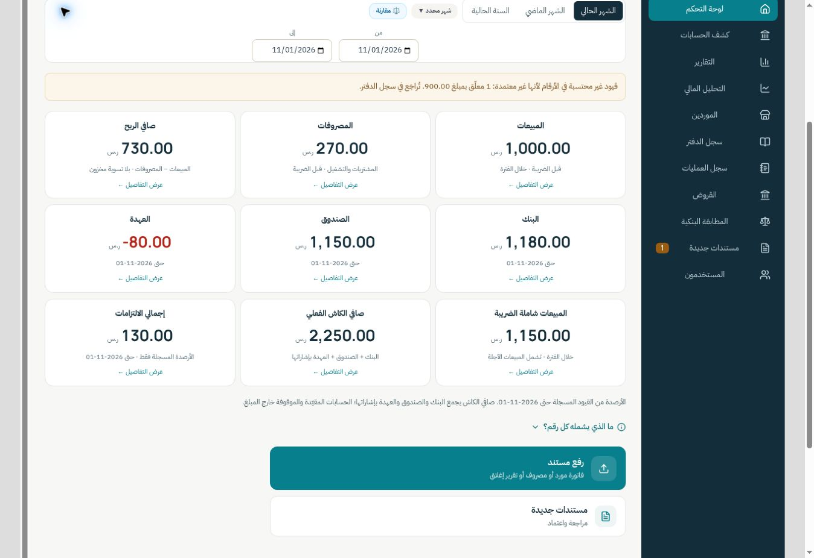

# Mazaher home review

Prepared on 2026-11-01 from production commit `46a99ad` (PR #38).

## Result

Only the selected business named `ديوانية مزاهر` or `مزاهر` gets the new nine-card layout:

| Row | Cards, in RTL reading order |
| --- | --- |
| 1 | المبيعات · المصروفات · صافي الربح |
| 2 | البنك · الصندوق · العهدة |
| 3 | المبيعات شاملة الضريبة · صافي الكاش الفعلي · إجمالي الالتزامات |

Pending review moves above the period filter. Charts and the expanded app-receivable breakdown are hidden on this home only. Reports remain available. Journal/archive navigation is replaced by operations; existing routes remain valid. Mazaher keeps loans and the independent ledger under their original role permissions. Tashormik's layout, bank-custody settings and loan visibility are unchanged.

The recorded-liabilities card sums existing supplier dues and any separately documented remaining obligation. Its card and dialog explicitly limit the scope to recorded balances. Unrecorded loan principal and tax balances are excluded; paid instalments are never treated as debt balances. A configured obligation with an unknown remaining balance shows `غير محدد`, not a partial total. This is a display aggregation, with no database or settings writes.

## Validation

- Production build: `npm run build` passed. Existing chunk-size, mixed-import and Browserslist warnings remain.
- 49 targeted tests passed:
  `node --test tests/recorded-liabilities.test.js tests/account-statement.test.js tests/liquidity-breakdown.test.js tests/balance-surfaces.test.js tests/finance-class.test.js tests/financial-analysis.test.js tests/admin-access.test.js tests/journal-entries.test.js`
- 21 browser checks passed through the real React pages with a synthetic read-only transport:
  - Nine centered cards, three per row at 320px; no card overflow. No page overflow at 375px. Three columns on desktop.
  - Home charts absent; explicit recorded-liability scope and synthetic total 130.
  - Accountant navigation retains loans and ledger; operations replaces journal/archive.
  - Operations account filter isolates cash movements.
  - Staff custody stays signed (-80) and matches the statement. Net cash (2,250) matches its statement.
  - Owner sees the review notice without its approval action; operations has no delete action; ledger permissions unchanged.
  - Supplier-query failure hides the financial figures, instead of presenting a partial liability total. Document-query failure appears separately while financial cards remain available.
  - Tashormik retains its prior home and hidden loans. An unrelated business retains its original home and separate journal/archive.
  - Period comparison remains visible on the main cards. Admin working in Mazaher retains review access and loans.

The browser used only synthetic data. No live account, production data or database update was involved. The two existing private database/browser scenarios have updated Mazaher navigation expectations but were not rerun; they require the private fixture. No production deployment was performed.

## Reproduce the browser fixture

After `npm run build`, run:

```sh
node tests/browser/prepare-mazaher-home.mjs /absolute/path/to/empty-preview-directory
```

Serve that directory using the supported local preview. `index.html` provides 320/375/1280px iframe viewports, and `app.html` contains the real Dashboard, Layout, Accounts and unified JournalLedger. Controls select the business, role and read-failure scenarios. Production Supabase is replaced at bundle time, and the fixture blocks outgoing connections through CSP.


